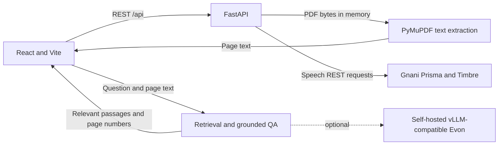

# Saar

Saar is a friendly document assistant that helps students and citizens make sense of official notices in English, Hindi, and Gujarati. Upload a text-based PDF, ask a question about it, and get an answer grounded in relevant passages with page references.

## The problem Saar addresses

Official notices can be dense, formal, and difficult to navigate. Saar is designed to make the information in a notice easier to find and understand while keeping the original document as the source of truth. If the notice does not contain enough information to answer a question, Saar should say so rather than fill in the gaps.

## Features

- Upload a PDF notice and extract selectable text page by page.
- Ask questions about the current document and view supporting passages with page citations.
- Use English, Hindi, or Gujarati for common scholarship-related question intents, including required documents, deadlines, amounts, eligibility, and application steps.
- Use local Hindi and Gujarati normalization and a small glossary for common document terms. This is targeted question understanding, not general-purpose translation.
- Access backend speech endpoints for Gnani Prisma transcription and Timbre speech generation.
- Check backend availability through a health endpoint.

## Demo and screenshots

Screenshots are not included yet. Add screenshots from a local run here when they are available; no demo URL or hosted deployment is currently provided.

## Architecture

Saar uses a React and Vite frontend with a Python and FastAPI backend. The browser communicates with the backend through REST endpoints; Vite proxies local `/api` requests to FastAPI during development.



### Document Q&A workflow

1. The browser sends the selected PDF to FastAPI. The backend validates and reads it in memory, then PyMuPDF extracts selectable text page by page.
2. The browser keeps the extracted page text for the current document session and sends that text with each question and the selected response language.
3. Saar normalizes supported Hindi and Gujarati question patterns, retrieves relevant document passages, and includes their page numbers in the response. If the text does not support an answer, Saar abstains.
4. If a compatible self-hosted Evon endpoint is configured, it can generate the answer from the retrieved passages. Otherwise Saar uses its local, extractive response path. Saar does not independently verify the notice against an official source.

PDFs and extracted text are not permanently stored by the backend. The Q&A endpoint is stateless: each question request contains the current document's extracted page text.

## Project structure

```text
saar/
|-- backend/
|   |-- app/
|   |   |-- __init__.py
|   |   |-- main.py             # Health, document, Q&A, and speech endpoints
|   |   |-- qa.py               # Retrieval and grounded answer logic
|   |   |-- qa_types.py         # Q&A request and response models
|   |   |-- evon.py             # Optional self-hosted Evon client
|   |   |-- gnani_speech.py     # Gnani Prisma and Timbre REST clients
|   |   `-- speech_types.py     # Speech endpoint models
|   |-- requirements.txt
|   |-- requirements-dev.txt
|   `-- tests/
|       |-- test_documents.py
|       |-- test_questions.py
|       `-- test_speech.py
|-- frontend/
|   |-- src/
|   |   |-- App.jsx             # Saar workspace
|   |   |-- main.jsx            # React entry point
|   |   `-- styles.css          # Responsive visual styles
|   |-- index.html
|   |-- package.json
|   |-- package-lock.json
|   `-- vite.config.js          # Local /api proxy to FastAPI
|-- .env.example
|-- .gitignore
`-- README.md
```

## Requirements

- Node.js 20.19+ or 22.12+
- npm (included with Node.js)
- Python 3.10+

## Run locally

Start the backend and frontend in separate terminals from the project root.

### 1. Configure optional Gnani speech access

Create a root-level `.env` file from the example if you want to use the Gnani-backed speech endpoints:

```powershell
# Windows PowerShell
Copy-Item .env.example .env
```

```sh
# macOS or Linux
cp .env.example .env
```

Set `GNANI_API_KEY` in `.env` to a key from your Gnani API dashboard. The backend reads the key from its process environment or this root-level file. `.env` is ignored by Git. Leave the value blank to run without Gnani access; speech requests return HTTP 503 with an unavailable-service message. Keep the key out of frontend variables and source code.

### 2. Start the backend

From the project root, create and activate a virtual environment, then install the backend dependencies.

```powershell
# Windows PowerShell
cd backend
python -m venv .venv
.venv\Scripts\Activate.ps1
python -m pip install -r requirements.txt
uvicorn app.main:app --reload --port 8000
```

```sh
# macOS or Linux
cd backend
python3 -m venv .venv
source .venv/bin/activate
python -m pip install -r requirements.txt
uvicorn app.main:app --reload --port 8000
```

The health endpoint is available at <http://127.0.0.1:8000/api/health>.

### 3. Start the frontend

In a second terminal:

```powershell
cd frontend
npm install
npm run dev
```

Open the local URL printed by Vite, usually <http://localhost:5173>. Vite forwards `/api` requests to `http://127.0.0.1:8000`.

## REST API

| Endpoint | Request | Behavior |
| --- | --- | --- |
| `GET /api/health` | None | Returns `{"status":"ok"}` when FastAPI is responding. |
| `POST /api/documents/upload` | Multipart field `file` containing a PDF | Extracts text per page and returns the filename, page count, combined text, page text, status, and any extraction message. Maximum upload size: 10 MB. Files are processed in memory. |
| `POST /api/documents/ask` | JSON containing `question`, `pages` (`page_number` and `text` per page), and `response_language` (`en`, `hi`, or `gu`) | Retrieves up to four relevant passages and limits model context to 4,000 characters. Returns an answer, source passages with page numbers, status, and answer mode. The request is limited to 1,000 pages and 1,000,000 total source characters. |
| `POST /api/speech/transcribe` | Multipart field `audio_file` | Uses Gnani Prisma v3.0 and automatic Indic language detection. Accepts WAV, MP3, OGG, FLAC, AAC, and M4A files, up to Saar's 10 MB upload limit. Gnani's transcription API accepts clips up to 30 seconds. |
| `POST /api/speech/synthesize` | JSON `{"text":"...","response_language":"en|hi|gu"}` | Uses Gnani Timbre v2.5 and returns WAV audio. Saar selects Kaveri for English, Nalini for Hindi, or Falak for Gujarati. |

The speech endpoints call Gnani directly from the backend using `GNANI_API_KEY` in the `X-API-Key-ID` header. They are synchronous and return clear errors for invalid input, HTTP 503 when the key or service is unavailable, and HTTP 504 for provider timeouts. Provider errors are sanitized. Automated tests mock Gnani responses and do not consume API credits.

The implementation follows the official [Prisma REST transcription guide](https://docs.gnani.ai/api/STT/speech-to-text), [Prisma v3.0 model guide](https://docs.gnani.ai/api/STT/models/prisma-v3), [Timbre REST guide](https://docs.gnani.ai/api/TTS/tts-inference), and [voice catalog](https://docs.gnani.ai/api/TTS/available-voices).

## Optional Evon configuration

Saar does not integrate a hosted Evon API. Its optional Evon client expects a self-hosted vLLM-compatible server with an OpenAI-compatible chat-completions endpoint. See the [Gnani Internship FAQ](https://www.gnani.ai/internship) and the [official Evon v3.3 model card](https://huggingface.co/gnani/gnani-evon-v3.3-30B-A3B/blob/main/README.md) for Gnani's current Evon information and model details.

Set these variables in the environment **before starting FastAPI**:

| Variable | Purpose | Default |
| --- | --- | --- |
| `SAAR_EVON_BASE_URL` | Base URL of the self-hosted server. Saar appends `/v1/chat/completions`; this setting is required to enable Evon. | Unset |
| `SAAR_EVON_MODEL` | Model name served by vLLM. | `gnani/gnani-evon-v3.3-30B-A3B` |
| `SAAR_EVON_API_KEY` | Optional Bearer token, only if the self-hosted server requires one. Keep credentials out of source control. | Unset |
| `SAAR_EVON_TIMEOUT_SECONDS` | Request timeout, bounded internally to 1–120 seconds. | `45` |

For example, in PowerShell:

```powershell
cd backend
$env:SAAR_EVON_BASE_URL = "http://127.0.0.1:30000"
$env:SAAR_EVON_MODEL = "gnani/gnani-evon-v3.3-30B-A3B"
# Set only if the self-hosted server requires a key:
$env:SAAR_EVON_API_KEY = "your-server-key"
uvicorn app.main:app --reload --port 8000
```

If Evon is not configured or the server fails, Saar does not silently switch to another model provider. It returns a grounded extractive response when the retrieved passages support one, or abstains when they do not.

## Multilingual Q&A behavior

English questions use the document retrieval pipeline directly. For Hindi and Gujarati, local Unicode normalization and intent matching recognize common ways of asking about five scholarship topics: required documents, application deadline, scholarship amount, eligibility, and application procedure. This includes common wording and word-order variations; it does not translate arbitrary questions into English.

Amount questions require an explicit amount or quantity cue. Questions about when a stipend will be paid are not treated as application-deadline questions, and ambiguous questions asking for multiple details receive a clarification or abstention. Common Hindi and Gujarati document terms can be rendered with a small local glossary; source passages remain in the language extracted from the PDF. Unsupported wording or translations outside this limited coverage may receive an abstention. Answers remain tied to retrieved passages and page citations.

## Tests and production build

Run backend tests from the project root after activating the backend virtual environment:

```powershell
cd backend
.venv\Scripts\Activate.ps1
python -m pip install -r requirements-dev.txt
python -m pytest
```

Build the frontend for production:

```powershell
cd frontend
npm run build
```

## Implemented scope and limitations

**Implemented:** selectable-text PDF extraction, document-grounded Q&A with page citations, common English/Hindi/Gujarati scholarship-question handling, the REST health endpoint, and backend integrations for Gnani Prisma transcription and Timbre speech generation.

**Not available or out of scope:** OCR for scanned or image-only PDFs; general-purpose Hindi/Gujarati translation; hosted Evon API integration in Saar; and independent verification of notice details against an official source. When Evon is not configured, local retrieval and extractive answers are used, and Saar abstains when the notice does not provide enough support. Gnani transcription is limited to clips up to 30 seconds by the provider.
